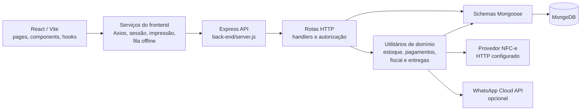
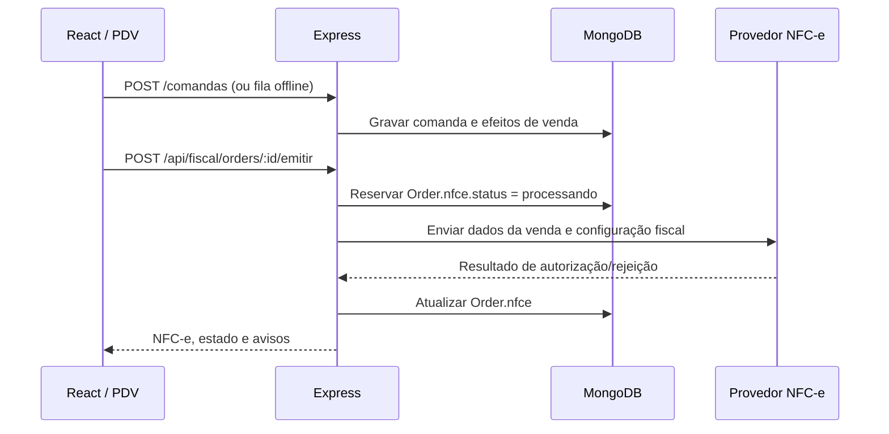

# Arquitetura observada

## Stack

- **Frontend:** React 19, React Router e Vite; manifestos usam faixas de versão
  npm (`front-end/package.json`).
- **Backend:** Node.js e Express 4, com Mongoose 8 e MongoDB
  (`back-end/package.json`).
- **Aplicação web instalável:** Vite PWA/Workbox. O service worker cacheia o
  shell e recursos estáticos; chamadas de API e respostas autenticadas usam
  `NetworkOnly` (`front-end/vite.config.js`).
- **Testes e qualidade:** Node test runner/Jest no backend, Node test runner e
  Cypress no frontend; scripts no `package.json` de cada pacote.

As faixas de versão acima vêm dos manifestos. O repositório não declara uma
versão mínima de Node nos manifestos consultados.

## Configuração de ambiente

O `.env.example` da raiz contém apenas uma observação. As variáveis de execução
do servidor estão em `back-end/.env.example`, incluindo `MONGO_URI`,
`JWT_SECRET`, configuração inicial de administrador, origens do frontend,
DeliveryLink/WhatsApp e NFC-e. O frontend lê `VITE_API_URL` para definir a base
da API e, se ausente, usa a URL de produção embutida em
`front-end/src/services/api.jsx`; não foi encontrado `.env.example` específico
do frontend.

## Componentes e responsabilidades

O backend registra as rotas em `back-end/server.js`. A lógica de requisição e
resposta é implementada principalmente nos próprios arquivos de rota, que
consultam modelos e chamam utilitários compartilhados. Há utilitários de domínio
como `pagamento.js`, `movimentarEstoqueVenda.js`, `nfce.js` e
`deliveryService.js`, mas não há uma divisão uniforme em diretórios separados
de controller/service/model. Descrever a arquitetura como três camadas formais
em todas as funcionalidades seria impreciso.

O frontend faz chamadas HTTP usando Axios (`front-end/src/services/api.jsx`).
Páginas, contextos, hooks e serviços ficam em `front-end/src/`; o backend expõe
as rotas sob `/api`, incluindo autenticação, vendas, comandas, produtos,
estoque, compras, produção, caixa, fiscal e entrega.

## Operação offline e sincronização

O suporte offline do PDV é uma fila local de **comandas/vendas**, não uma cópia
offline geral da API:

1. A tela de PDV tenta enviar a comanda a `POST /comandas`. Se o navegador está
   offline ou a requisição falha por indisponibilidade/timeout/erro de servidor,
   preserva o carrinho e enfileira a operação.
2. A fila é guardada no IndexedDB (`pdv_offline`, object store `fila`), com
   limite de 50 registros. O endpoint permitido pelo sincronizador é
   `/comandas`. Cada operação inclui `idTemporario` e a identidade do operador
   e do tenant capturada localmente.
3. Quando a conexão volta, ou a tela detecta a fila, o sincronizador reivindica
   uma operação com lease persistente e envia `Idempotency-Key`. O backend
   revalida a origem do operador/tenant e usa a chave para deduplicar tentativas.
4. Em caso de sucesso, o item sincronizado é removido. Falhas são tentadas
   novamente; inconsistência de origem é preservada em quarentena para revisão,
   em vez de ser associada automaticamente a outro usuário.
5. O service worker não armazena em cache as respostas da API. O cache offline
   da PWA cobre os arquivos da aplicação; a fila IndexedDB é o mecanismo
   específico para registrar venda/comanda durante indisponibilidade.

Fontes principais: `front-end/src/pages/PDV.jsx`,
`front-end/src/hooks/useFilaOffline.js`,
`front-end/src/services/offlineStore.js` e
`back-end/routes/comandas.js`.

## Fluxo de venda e NFC-e

O endpoint fiscal efetivo é montado como
`POST /api/fiscal/orders/:id/emitir` (`back-end/routes/fiscal.js`). O emissor
está em `back-end/utils/nfce.js` e faz uma chamada HTTP para `NFCE_PROVIDER_URL`;
não há evidência de comunicação direta implementada com a SEFAZ. O código exige
configuração empresarial, certificado e provedor, e reserva atomicamente o
estado `processando` para evitar envio duplicado. Em timeout ou resposta
indeterminada, mantém o estado para reconciliação e não reemite
automaticamente. O resultado é salvo em `Order.nfce`; informações de estado
fiscal do pagamento ficam em `Order.pagamentos[].fiscal`.

Variáveis fiscais documentadas no `back-end/.env.example` incluem
`FISCAL_AMBIENTE`, `NFCE_SERIE`, `NFCE_PROVIDER_URL`, `NFCE_PROVIDER_TOKEN`,
dados cadastrais da empresa e certificado. O exemplo contém um endereço
placeholder `.example`; a escolha/configuração de provedor real não está
determinada pelo código do repositório.

## Entregas / DeliveryLink

O escopo documentado como atual é a funcionalidade de entrega servida pelo
backend Express do PDV, na rota `back-end/routes/delivery.js`, com modelos no
mesmo MongoDB. O processador `back-end/utils/deliveryOutbox.js` integra
comandas fechadas a pedidos de entrega por uma fila durável e referência
idempotente. O template em `scripts/deliverylink-hub-template/` é separado e
não faz parte da arquitetura operacional integrada descrita aqui.

No fluxo de entrega presente no PDV, o rastreio usa Server-Sent Events (SSE)
com polling de contingência; telas administrativas consultam periodicamente.
Atualizações push e Socket.IO não estão implementados nesta versão; foram
indicados como evolução futura e não devem substituir nem interromper o fluxo
SSE/polling em uso. O envio automático opcional usa a API oficial WhatsApp
Cloud quando `WHATSAPP_API_URL` e `WHATSAPP_ACCESS_TOKEN` estão configurados.
Sem provedor, o backend devolve link, mensagem pronta e URL `wa.me` para
compartilhamento manual.

## [DECISÃO PENDENTE]

- O backend chama um provedor configurável, mas o `.env.example` não identifica
  fornecedor real. Qual provedor/contrato fiscal deve ser considerado quando
  essa configuração for preenchida?

## Direções futuras e compatibilidade

- Socket.IO e notificações push são evoluções futuras, não dependências da
  versão atual.
- O escopo de arquitetura atual de DeliveryLink é somente a integração que roda
  no backend do PDV. O template de Hub independente não é tratado como serviço
  conectado ao PDV.
- Qualquer alteração futura deve manter o comportamento e as interfaces da
  versão atual durante a transição. Adições devem ser compatíveis com os
  clientes e dados persistidos existentes; não remover ou substituir
  imediatamente o SSE, polling, rotas ou campos em uso.
