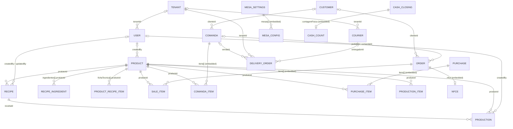

# Modelo de dados

## Escopo e convenções

Este documento descreve os schemas Mongoose encontrados em `back-end/models/`.
Os campos e relações são os do código atual; nomes conceituais solicitados que
não correspondem a uma coleção própria estão identificados como embutidos ou
configurações. Um `ObjectId` com `ref` é uma referência lógica do Mongoose, não
uma chave estrangeira imposta pelo MongoDB.

As decisões confirmadas abaixo são direcionamento de modelagem, não descrição
de código já implementado. Qualquer evolução deve preservar leitura e operação
dos registros, payloads e clientes da versão atual; migrações devem ser
aditivas/compatíveis, sem remover de imediato os campos existentes.

Salvo indicação em contrário, os schemas sem `timestamps: true` não recebem
automaticamente `createdAt` e `updatedAt`. Campos em subdocumentos podem não ter
`_id` quando isso está explicitamente desativado no schema.

## Diagrama

As entidades `SALE_ITEM`, `COMANDA_ITEM`, `RECIPE_INGREDIENT`, `MESA_CONFIG`,
`CASH_COUNT` e `NFCE` no diagrama representam subdocumentos, não coleções
Mongoose independentes. `Insumo` também não tem coleção própria: é um `Product`
com `tipo: "insumo"`.

## Dicionário

### Produto e insumo — `Product`

Arquivo: [`back-end/models/Product.js`](../back-end/models/Product.js).

| Campo | Tipo Mongoose | Uso / restrições observadas |
|---|---|---|
| `tipo` | String enum | `venda` ou `insumo`; padrão `venda`. |
| `tipoProduto` | String enum | `revenda`, `coz` ou `producao`; padrão `revenda`. |
| `codigo` | String | Obrigatório, único, aparado. |
| `nome` | String | Obrigatório, aparado e indexado. |
| `categoria` | String enum | `Bebidas Quentes`, `Bebidas geladas`, `Salgados`, `Doces`, `Congelados`, `Sorvetes`, `Pratos na Hora`, `Insumos` ou `Outros`; padrão `Outros`. |
| `ncm` | String | Código fiscal textual; padrão vazio. |
| `unidade` | String enum | Unidade do cadastro; padrão `un`. Usa `UNIDADES_PERMITIDAS`. |
| `quantidade` | Number | Quantidade-base, mínimo `0.001`; casas decimais validadas pela unidade. |
| `rendimento` | Number ou null | Rendimento do produto; padrão null. |
| `unidadeVenda`, `unidadeCompra`, `unidadeConteudo` | String enum | Unidades de venda, compra e conteúdo da embalagem; padrão `un`. |
| `marcaReferencia` | String | Marca/referência textual; padrão vazio. |
| `conteudoPorEmbalagem` | Number | Conteúdo por embalagem; padrão `0`. |
| `estoqueEmbalagens`, `estoqueConteudoAberto` | Number | Quantidade de embalagens e conteúdo aberto em estoque; padrão `0`. |
| `estoqueMinimoEmbalagens` | Number | Estoque mínimo de embalagens; padrão `0`. |
| `rendimentoPorUnidadeCompra` | Number | Conversão/rendimento de unidade de compra; padrão `0`. |
| `pesoPorUnidade` | Number | Peso unitário; padrão `0`. |
| `unidadePeso` | String enum | Atualmente `kg`; padrão `kg`. |
| `vendidoFracionado`, `aFazer`, `permitirVendaSemInsumo` | Boolean | Opções de venda/preparo; padrões false. |
| `fichaTecnica` | Array de subdocumentos | Cada item contém `produtoId` (ObjectId `ref: Product`), `quantidade` (Number > 0) e `unidade` (String enumerada). Padrão `[]`. |
| `preco` | Number | Obrigatório, mínimo `0`. |
| `descontosPorQuantidade` | Array de subdocumentos | `quantidadeMinima` (Number), `precoUnitario` (Number) e `ativo` (Boolean). |
| `grupoDesconto` | Subdocumento opcional | `nome` (String), `quantidadeMinima` e `precoPromocional` (Number), `ativo` (Boolean). |
| `custo`, `custoUnitario`, `custoUnitarioBase`, `custoUltimoSalvo` | Number | Campos de custos; padrões `0`. |
| `precoCompra` | Number | Obrigatório para `tipo: "insumo"` ou `controladoComoInsumo: true`; o default depende dessas condições. |
| `custoCalculado` | Number ou null | Custo calculado; padrão null. |
| `dataUltimoCalculo` | Date ou null | Data do último cálculo; padrão null. |
| `fonteCalculo` | String enum | `insumo`, `manual` ou `indisponivel`; padrão `indisponivel`. |
| `reajusteRecomendado` | Boolean | Indicador; padrão false. |
| `estoque`, `estoquePesoKg`, `estoqueInsumos` | Number | Saldos de estoque; padrões `0`. `estoque` é obrigatório. |
| `estoquePesoNormalizado` | Boolean opcional | Indicador legado/normalização, sem default no schema. |
| `estoqueMinimo`, `estoqueMinimoInsumos`, `estoqueMinimoBase` | Number | Limites mínimos; padrões `5`, `0` e `0`. |
| `estoqueInsumosInicial`, `estoqueInicialDia` | Number opcional | Valores iniciais; mínimo `0`. |
| `estoqueInsumosInicialData`, `estoqueInicialData` | String opcional | Datas registradas como texto. |
| `producaoPropria`, `controladoComoInsumo`, `usavelEmReceita`, `ativo` | Boolean | Indicadores; `ativo` padrão true, demais false. |
| `estoqueMaximo` | Number | Limite máximo; padrão `100`, mínimo `0.001`. |
| `rendimentoPorReceita` | Number | Rendimento associado à receita; padrão `1`. |
| `createdBy` | ObjectId `ref: User` | Usuário que criou o cadastro. |
| `createdAt` | Date | Padrão `Date.now`; não há `timestamps` gerais neste schema. |

### Ficha técnica — `Product.fichaTecnica` e `Recipe`

A ficha simples embutida no produto contém componentes (`produtoId`, quantidade
e unidade), cada um apontando para outro `Product`. Também existe o modelo
independente `Recipe`, em [`back-end/models/Recipe.js`](../back-end/models/Recipe.js):

| Campo | Tipo Mongoose | Uso |
|---|---|---|
| `nome` | String | Nome obrigatório da receita. |
| `produtoId` | ObjectId `ref: Product` | Produto resultante da receita. |
| `rendimento` | Number | Rendimento obrigatório, maior que zero. |
| `unidadeRendimento` | String enum | Unidade do rendimento. |
| `ingredientes` | Array de subdocumentos | Um ou mais itens com `produtoId` (`ref: Product`), `quantidade` (Number > 0) e `unidade`. |
| `ativo`, `ativa` | Boolean | Indicadores separados; ambos têm default true. |
| `custoInsumosTotal`, `custoEmbalagem`, `custoIndireto`, `maoDeObra`, `custoTotal`, `custoUnitario` | Number | Valores de composição/cálculo de custo; padrões `0`. |
| `createdBy`, `updatedBy` | ObjectId `ref: User` | Autoria de criação/alteração. |
| `updatedAt` | Date | Campo explícito; o schema também habilita `timestamps: true`. |

O código mantém as duas formas (`Product.fichaTecnica` e `Recipe`); o documento
não presume que sejam intercambiáveis em todos os fluxos.

**Direção confirmada:** `Product.fichaTecnica` será a representação canônica
da composição de ingredientes do produto. `Recipe` permanece documentado como
modelo existente usado por fluxos atuais, inclusive produção; essa decisão não
remove nem migra esse modelo nesta alteração documental. Uma futura
consolidação deverá manter compatibilidade com receitas e produções já
persistidas.

### Venda — `Order`

Arquivo: [`back-end/models/Order.js`](../back-end/models/Order.js). O número é
gerado como texto com seis dígitos; o schema usa `timestamps: true`.

| Campo | Tipo Mongoose | Uso |
|---|---|---|
| `numero`, `idTemporario` | String | Número único gerado; identificador temporário único e esparso. |
| `itens` | Array embutido | Ver `ItemVenda` abaixo. |
| `subtotal`, `total` | Number | Obrigatórios, mínimos `0`. |
| `taxaEntrega`, `desconto` | Number | Valores monetários; padrão `0`. |
| `utilizacaoInterna` | Boolean | Padrão false. |
| `clienteId` | ObjectId `ref: Customer` | Cliente opcional; nome e telefone também são armazenados como texto no pedido. |
| `status` | String enum | `pendente`, `pago`, `parcial` ou `cancelado`; padrão `pendente`. |
| `pagamentos` | Array de subdocumentos | Pagamentos, incluindo forma, valores, taxas, estado e dados fiscais do pagamento. |
| `nfce` | Subdocumento embutido | Situação e dados da NFC-e; ver seção NFC-e. |
| `atendente` | String | Obrigatório. |
| `observacao` | String | Observação opcional. |
| `comandaId` | ObjectId `ref: Comanda` | Comanda relacionada, quando houver. |
| `transferenciasComanda` | Array de subdocumentos | Origem, comanda de destino, data e usuário da transferência. |
| `tipoAtendimento` | String enum | `mesa`, `balcao`, `retirada` ou `delivery`; padrão `mesa`. |
| `createdAt`, `updatedAt` | Date | Gerados por `timestamps: true`. |

#### Item de venda — subdocumento em `Order.itens`

Não existe modelo ou coleção `ItemVenda`. Os dois schemas de item (em `Order` e
`Comanda`) são declarados separadamente e têm estes campos:

| Campo | Tipo Mongoose | Uso |
|---|---|---|
| `produtoId` | ObjectId `ref: Product` | Produto do item. |
| `codigo`, `nome` | String | Códigos/descrição persistidos no item; `nome` é obrigatório. |
| `precoUnitario`, `custoUnitarioHistorico`, `precoUnitarioOriginal`, `precoUnitarioManual` | Number | Preço atual e valores de referência/custo; preço unitário é obrigatório. |
| `controleEstoque` | String enum | `produto`, `insumos` ou `nenhum`. |
| `movimentoEstoque` | Subdocumento | `pecas` e `pesoKg` (Number). |
| `descontoQuantidade`, `economiaQuantidade`, `faixaDescontoQuantidade`, `totalGrupo`, `faltamParaGrupo` | Number | Valores/limites de desconto e grupo. |
| `grupoDescontoAtivo` | Boolean | Indicador do grupo promocional. |
| `quantidade` | Number | Obrigatório e maior que zero. |
| `unidadeVenda` | String enum | Unidade usada para vender. |
| `pesoPorUnidade`, `pesoVendidoKg`, `quantidadePecas` | Number | Dados de venda por peso/peças. |
| `unidadePeso` | String enum | Unidade de peso; enum `kg`. |
| `tipoVenda` | String enum | `inteiro`, `peso` ou `unidade`. |
| `modificadores` | Array de String | Modificadores do item; padrão `[]`. |
| `aFazer` | Boolean | Indicador de preparo. |
| `insumosConsumidos` | Array de subdocumentos | Cada item contém `produtoId` (`ObjectId ref: Product`), `quantidade` (Number) e `unidade` (String enum). |

O subdocumento de pagamento contém `tipo` (String validada como forma de
pagamento), `valorRecebido`, `taxaPercentual`, `taxaValor` e `valorLiquido`
(Number), `rotuloPagamento` e `observacao` (String), `dataPagamento` (Date),
`quitado` (Boolean), `comandaId` (ObjectId `ref: Comanda`) e `fiscal`
(subdocumento com estado, documento, chave, mensagem e data de emissão).

### Comanda — `Comanda`

Arquivo: [`back-end/models/Comanda.js`](../back-end/models/Comanda.js). Usa
`timestamps: true`; o número é gerado como texto com quatro dígitos.

| Campo | Tipo Mongoose | Uso |
|---|---|---|
| `numero`, `idTemporario` | String | Número único gerado; identificador temporário único e esparso. |
| `idempotencyKey`, `idempotencyHash` | String | Chave e hash usados para idempotência. |
| `clienteNome`, `clienteTelefone`, `observacao` | String | Dados textuais da comanda. |
| `clienteId` | ObjectId `ref: Customer` | Cliente opcional. |
| `tipoAtendimento` | String enum | `mesa`, `balcao`, `retirada` ou `delivery`; padrão `mesa`. |
| `statusBalcao` | String enum | `aguardando`, `preparando`, `pronto`, `pago` ou `entregue`. |
| `mesa` | String | Nome/número descritivo; não é referência a um documento Mesa. |
| `itens` | Array embutido | Itens da comanda; ver nota abaixo. |
| `taxaEntrega`, `desconto`, `valorTotal`, `valorPago`, `saldoDevedor` | Number | Valores monetários; padrões `0`. O estado de pagamento é recalculado antes de salvar. |
| `statusPagamento` | String enum | `pendente`, `parcial`, `quitado` ou `cancelado`. |
| `historicoPagamentos` | Array de subdocumentos | Valor, forma, rótulo, taxas, valor líquido, data, observação e usuário. |
| `utilizacaoInterna`, `estoqueBaixado` | Boolean | Indicadores; padrão false. |
| `status` | String enum | `rascunho`, `aberta`, `fechada` ou `cancelada`; padrão `aberta`. |
| `atendente` | String | Obrigatório. |
| `entrega` | Subdocumento opcional | Dados e estado de integração da entrega: usuário/tenant, telefone/endereço, taxa, `pedidoEntregaId`, estado, tentativas e erro. |
| `pedidoId` | ObjectId `ref: Order` | Pedido associado, quando criado. |
| `createdAt`, `updatedAt` | Date | Gerados por `timestamps: true`. |

Os itens são subdocumentos próprios de `Comanda` (com os campos de item acima); não há uma coleção compartilhada
`ItemVenda`.

### Cliente — `Customer`

Arquivo: [`back-end/models/Customer.js`](../back-end/models/Customer.js).

| Campo | Tipo Mongoose | Uso |
|---|---|---|
| `nome` | String | Obrigatório e aparado. |
| `telefone`, `endereco`, `aniversario`, `cpf` | String | Campos opcionais. |
| `enderecoEntrega` | Subdocumento opcional | Rua, número, bairro, complemento e referência. |
| `cafesFidelidade` | Number | Inteiro seguro, mínimo `0`, padrão `0`. |
| `clienteInterno` | Boolean | Padrão false; há índice único parcial para manter no máximo um marcado como interno. |
| `createdBy` | ObjectId `ref: User` | Usuário que cadastrou. |
| `createdAt` | Date | Padrão `Date.now`. |

O telefone tem índice único parcial quando preenchido; nome e telefone também
estão em índice de texto.

### Mesa — `MesasSettings`

Arquivo: [`back-end/models/MesasSettings.js`](../back-end/models/MesasSettings.js).
Não há coleção `Mesa`: há um documento de configurações (`_id: "principal"`)
com `mesas`, um array embutido de `{ id: Number, numero: Number, nome: String,
lugares: Number, ativa: Boolean }`, e `oferecerBalcao` (Boolean, padrão true).
O schema usa timestamps. A comanda mantém `mesa` como String, sem `ref` para
essa configuração.

**Direção confirmada:** a comanda deve referenciar uma mesa configurada.
Atualmente, contudo, `Comanda.mesa` ainda é String e `MesasSettings` ainda
guarda as mesas em array embutido. A referência futura não está implementada;
uma mudança deverá preservar os valores textuais e comandas existentes durante
a transição, sem quebrar clientes da versão atual.

### Fechamento de caixa — `FechamentoCaixa`

Arquivo: [`back-end/models/FechamentoCaixa.js`](../back-end/models/FechamentoCaixa.js).
O schema usa timestamps.

| Campo | Tipo Mongoose | Uso |
|---|---|---|
| `data` | Date | Obrigatório e indexado. |
| `usuarioAbertura`, `usuarioFechamento` | String | Responsáveis registrados como texto. |
| `turno` | String | Obrigatório; padrão `principal`. |
| `tipoRegistro` | String enum | `fechamento` ou `ajuste`; padrão `fechamento`. |
| `chaveAbertura` | String | Chave opcional, com índice único parcial para fechamentos. |
| `fechamentoOriginalId` | ObjectId `ref: FechamentoCaixa` | Fechamento relacionado a ajuste. |
| `ajusteValor`, `ajusteMotivo` | Number / String | Dados do ajuste. |
| `sistema` | Subdocumento | `saldoAnterior`, `entradasDinheiro`, listas `sangrias` e `suplementacoes`, `saldoEsperado`. Cada movimento tem valor, responsável, motivo e data. |
| `contagemFisica` | Subdocumento | Ver abaixo. |
| `conferencia` | Subdocumento | Diferença, situação (`conferido`, `faltante`, `sobrando`), observação e data da conferência. |
| `outrosMeios` | Subdocumento | Personalizados, PIX, crédito, débito, crédito loja, taxas, valores líquidos e totais. |
| `status` | String enum | `aberto` ou `fechado`; padrão `aberto`. |

`usuarioAbertura` e `usuarioFechamento` são Strings; o schema não declara
referência Mongoose a `User`.

#### Contagem física — subdocumento `contagemFisica`

Não existe modelo `ContagemFisica`. O campo contém `valorContado`, listas
`cedulas` e `moedas` (itens com `valor` e `quantidade`), `totalCedulas`,
`totalMoedas` e `totalDinheiro`.

### NFC-e — subdocumento de `Order`

Não existe modelo `Nfce` independente. `Order.nfce` é subdocumento sem `_id`:

| Campo | Tipo Mongoose | Uso |
|---|---|---|
| `status` | String enum | `nao_emitida`, `processando`, `autorizada`, `rejeitada` ou `cancelada`. |
| `numero`, `serie`, `chaveAcesso`, `protocolo`, `xml`, `danfePdf`, `mensagemSeErro` | String | Dados do documento ou da resposta fiscal. |
| `dataEmissao`, `dataTentativaEmissao` | Date | Datas de emissão e tentativa. |

### Pedido de entrega — `PedidoEntrega`

Arquivo: [`back-end/models/PedidoEntrega.js`](../back-end/models/PedidoEntrega.js).
O schema usa `criadoEm` e `atualizadoEm` como timestamps.

| Campo | Tipo Mongoose | Uso |
|---|---|---|
| `tenantId` | ObjectId `ref: Tenant` | Obrigatório e imutável. |
| `fonte` | String enum | `pdv`, `formulario`, `api` ou `whatsapp`. |
| `origem` | Subdocumento | `nomeCliente` e `telefone` (String) e `endereco` obrigatório. O endereço tem `rua`, `numero`, `complemento`, `bairro` e `referencia` (String). |
| `itens` | Array de subdocumentos | Cada item tem `descricao` (String), `quantidade` e `precoUnitario` (Number). |
| `valorTotal`, `taxaEntrega` | Number | Total obrigatório e taxa padrão `0`. |
| `status` | String enum | `pendente`, `pronto`, `despachado`, `a_caminho`, `entregue` ou `cancelado`; padrão `pendente`. |
| `statusHistorico` | Array de subdocumentos | Estado, autor (`tenant`, `entregador` ou `sistema`), `usuarioId` quando aplicável e data. |
| `tokenRastreamento` | String | UUID v4, obrigatório, único e imutável. |
| `vendaId` | ObjectId `ref: Comanda` | Comanda do PDV associada. |
| `entregadorId` | ObjectId `ref: Entregador` | Entregador atribuído, se houver. |
| `referenciaIntegracao` | String | Referência externa; índice único parcial por tenant. |
| `motivoCancelamento` | String | Motivo opcional. |
| `whatsappPendente` | Boolean | Padrão false. |
| `tempoEstimadoMinutos` | Number | Inteiro; padrão `30`, mínimo `1`. |
| `criadoEm`, `atualizadoEm` | Date | Timestamps nomeados pelo schema. |

### Usuário — `User`

Arquivo: [`back-end/models/User.js`](../back-end/models/User.js).

| Campo | Tipo Mongoose | Uso |
|---|---|---|
| `username` | String | Obrigatório, único, validado, entre 2 e 254 caracteres. |
| `password` | String | Obrigatória, não selecionada por padrão em consultas; hash criado no hook `save`. |
| `role` | String enum | `admin`, `operador`, `cozinha`, `garcom`, `admin_plataforma`, `tenant_admin` ou `entregador`; padrão `operador`. |
| `ativo` | Boolean | Padrão true. |
| `tokenVersion` | Number | Inteiro seguro, mínimo `0`, padrão `0`. |
| `email` | String | Opcional, único esparso, normalizado em minúsculas e validado. |
| `tenantId` | ObjectId `ref: Tenant` | Tenant associado, quando aplicável. |
| `createdAt` | Date | Padrão `Date.now`. |

O modelo de entregador de rota também existe separadamente (`Entregador`, com
telefone, senha de acesso, estado e posição); portanto, o papel `entregador` em
`User` não deve ser interpretado como prova de que ambos compartilham o mesmo
registro.

## Outros modelos relacionados

`Purchase` registra compras e itens de produtos; `Production` registra produção
com referências a `Recipe`, produto resultante e insumos; `StockMovement`
registra movimentos com referência a `Product`; `Tenant` e `Entregador` apoiam a
entrega; `RecipeAudit` mantém auditoria de receitas. Esses são schemas próprios
em `back-end/models/`, embora não sejam entidades centrais da lista acima.

## Decisões confirmadas e compatibilidade

- `Product.fichaTecnica` é a fonte canônica escolhida para a composição dos
  produtos; o modelo `Recipe` atual deve continuar funcionando até uma
  evolução compatível.
- A comanda deverá referenciar a mesa configurada. O campo textual existente
  não deve ser removido nem tornar registros atuais ilegíveis sem uma migração
  compatível.
- `ItemVenda`, `ContagemFisica` e NFC-e permanecem embutidos; não há decisão
  para convertê-los em coleções independentes.
- Nenhuma das direções acima foi implementada por esta documentação.
